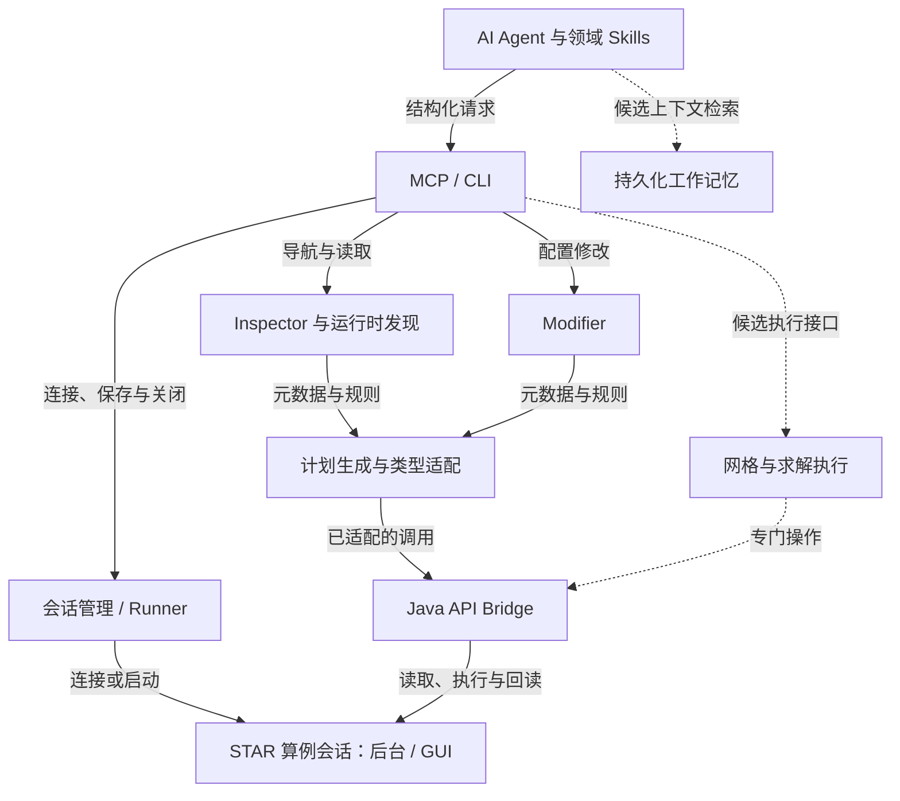

# StarBridge 目标设计

[项目入口](../README.cn.md) · [当前工作](../../TODO.md) · [路线图](../roadmap.md) · [参考项目](../tech/references.md)

## 项目定位

**StarBridge** 面向 AI Agent 提供 STAR-CCM+ 交互能力。目标是通过 Skills、MCP、自动化 Bridge 和工作记忆，支持算例的结构化读取、修改、执行与结果核对；其中尚未实现的部分仍是目标设计。

本文维护项目定位、目标架构和候选方向，不作为当前功能或进度清单。当前实现与源码关系见[技术入口](../tech/index.md)，任务状态见 [TODO](../../TODO.md)，未来候选见[路线图](../roadmap.md)。

运行时发现方向采用 [ADR 0001](../adr/0001-runtime-discovery.md)。会话接入、三端插件、保存和简化后的写入行为以 [ADR 0002](../adr/0002-plugins-sessions-and-storage.md)及其[规格](../archive/spec-2026-11-03-14-23.md)为准：不再强制副本或全快照不变检查；新实现的运行验证边界见[会话说明](../tech/bridge-session.md#验证边界)。

这里的“验证”限定为检查操作是否成功、设置是否按预期改变，以及是否产生非预期修改。验证 CFD 结果可信性不属于当前定位；Agent 可以结合知识储备、技术文本和工作记忆判断物理合理性与网格质量，当前暂不考虑收敛性判断。

配置读写的目标是覆盖算例本身所有可修改参数和选项，包括几何、网格、物理模型、边界条件、求解器、后处理及操作流程。客户端偏好、安装配置等不在此范围内。覆盖以明确 STAR 版本的发现机制、适配规则和验证记录推进，不将已有少量对象接口或一个算例的对象清单等同于全量支持。

---

## 核心能力

StarBridge 计划提供以下能力：

* 按实际对象层级发现节点、属性和关系，提供按需导航与搜索
* 通过版本依据、通用规则和类型适配器生成计划并读取算例设置
* 查询参数、场函数、标签和对象属性
* 检查物理模型、区域、边界和接口
* 检查和修改网格操作及网格控制参数
* 修改全局参数和模型设置
* 创建或修改 Simulation Operations
* 执行网格生成和求解
* 保存新的 `.sim` 文件
* 对修改前后的算例进行 Diff，并验证操作结果
* 为 AI Agent 提供 STAR-CCM+ 工作流知识
* 支持 StarBridge 服务常驻，以及后台或 GUI 算例会话常驻
* 持久化用户偏好、项目约定、算例知识和工作记录，为后续操作提供上下文

---

## 总体架构



实线表示目标架构中的职责关系，虚线表示尚待设计的执行和记忆能力；不据此判断实现进度。当前进程与组件的 C4 图见[当前架构](../tech/architecture.md)。

目标架构中，Inspector 与 Modifier 共享运行时对象身份、属性描述及适配规则。Inspector 沿实际对象层级导航、搜索并读取当前状态；Modifier 承接已适配的属性或结构操作。Bridge 根据运行时描述符、具体版本的 API 声明和规则生成明确计划，执行器按类型或操作语义处理。当前发现与受控写入的实现范围见[运行时发现](../tech/runtime-discovery.md)，后续迁移按 [TODO](../../TODO.md)推进。

对外提供少量稳定接口。新属性符合已接受的通用规则时按需生成计划，不要求先逐项补齐人工配置清单；新机制和复杂语义再扩展适配器或例外。保留 STAR 的名称与上下文，不要求完全复刻 GUI。单个对象的版本差异不应散落在多个 CLI 命令、MCP Tool 或 Skill 中。

网格生成和求解属于执行能力；会话启停、保存和关闭属于生命周期管理。它们与 Modifier 配合，并保持独立的调用语义。工作记忆提供用户、项目和算例背景，实时事实仍来自当前会话。

---

## 版本化对象、属性与操作目录

目标设计将版本材料、通用规则、特殊条件与自动生成计划分开维护；目录不再承担完整的逐属性人工支持清单。STAR 产品版本、Build、规则和格式版本分别记录，不能默认相邻版本兼容。已登记版本及证据统一见[版本说明](../tech/catalog-versions.md)。

### 目录描述什么

版本资料描述 API 类型与规则依据，不保存某个算例的对象实例或当前参数值；运行时发现负责实例、属性及关系。下表描述版本材料需要表达的信息；运行时发现的既定要求见[发现规格](../archive/spec-2026-10-30-12-24.md)，当前简化要求见[现行规格](../archive/spec-2026-11-03-14-23.md)。

| 内容 | 需要描述的信息 |
|---|---|
| 对象类型与访问关系 | 类型标识、Java 类、所属管理器、查找路径、构造或工厂操作、关联对象类型 |
| 属性 | 属性标识、读写方法及签名、值类型、单位与量纲、枚举、对象引用、集合或查询语义 |
| 约束与可写条件 | 只读声明、数值范围、模型或方法前提、状态依赖、条件的运行时检查方式 |
| 操作 | 创建、删除、启停模型、切换方法、调整结构等操作的参数、前提、影响对象和回读方式 |
| 执行映射 | 使用的类型或特殊操作适配器、必要的调用顺序及结果解释规则 |
| 来源与覆盖 | 对应版本的 API 材料、人工补充依据、生成信息、适配及实际验证状态 |

初始类型适配覆盖基础数值、布尔、字符串、枚举、数量与表达式、向量或张量、对象引用、集合和动态查询。新增对象尽量复用已有适配器；出现新的数据类型或操作语义时再扩展执行器。

张量 Profile 与材料系数不能假定使用同一矩阵布局。分量顺序、二维／三维方向、方法读取副作用及已适配类型统一见[张量读取格式](../tech/catalog-runtime.md#张量读取格式)、[材料物性与系数](../tech/catalog-runtime.md#材料物性与系数)和[修改契约](../tech/catalog-modifier.md)。

属性名称和 setter 只说明部分调用信息，单位转换、方法切换及查询规则也必须保留。例如，动态选择器需要保留查询本身；参数表达式的 SI 单位行为应进入数量适配规则。特殊行为通过有依据的规则补充，不能仅凭方法名推断。

### 目录生成与版本维护

1. 从对应版本的 Javadoc、类签名和属性元数据生成候选目录，记录材料来源与版本。
2. 结合运行时 Bean 描述符和对象关系，按已接受的类型规则生成所需计划；人工语义、特殊访问和禁止规则独立维护，重复生成不能覆盖这些补充。
3. 结合宏录制和代表性算例核对规则与特殊操作，分别记录只读和写入证据；发现 API 不等于已经验证修改行为。
4. 为另一版本生成目录，比较新增、删除、签名、值类型及元数据变化；改名或等价替换只能作为候选，经确认后建立映射。
5. 普通签名变化通过版本材料与生成计划比较处理；数据类型、调用效果或操作语义变化需要更新规则、适配器和验证依据。

GUI 对算例的修改所对应的 Java 宏是建立和核对映射的重要依据。目录应能持续增补能力，而不是为每个对象另建一套工具。候选目录 v1 的生成、合并和比较方式见[目录工具](../tech/catalog.md)；已经实现的只读调用管线与类型适配见[运行时契约](../tech/catalog-runtime.md#人工执行映射)，属性修改与结构操作契约见[目录修改](../tech/catalog-modifier.md)。

### 版本能力与运行状态

版本目录描述该版本提供哪些对象类型、属性和操作。运行时状态描述当前算例有哪些实例、启用了哪些模型或方法，以及某项属性此刻是否可写。尚未在当前算例中实例化的类型仍属于版本目录。

安装与版本选择来自用户明确指定或实际环境探测，工具说明和 Skill 不固定推荐某个 release/Build。`discover_installations` 返回所选程序实际报告的版本；`get_capabilities` 按当前注册表回答该版本的支持情况，省略版本时只列支持范围；`open_session` 从程序探测版本并核对用户提供的可选预期。检测到未适配版本时保留真实版本和缺口，不冒用邻近目录、不自动替换安装。支持注册表、实际安装和运行中算例状态分别表达；新增适配不应要求修改通用调用指令。

目标设计以运行时发现作为对象定位与属性访问的主要入口。目录外属性符合已接受规则时可以生成只读计划；未知机制、条件或类型保留为有原因的描述结果。现有基础值和已登记 input 类型已可按运行时描述符及 Javadoc 自动编译读取计划；未登记的复杂语义仍需规则、适配器或特殊映射。类型元数据和缓存不能替代会话身份、当前模型状态及实际操作检查。

对象定位需要区分会话内引用和文件重新加载后的定位方式。当前目录读写入口使用明确的类型、名称和父路径重新定位，以会话 token 和 STAR 对象 key 核对同会话引用；具体契约见[目标身份](../tech/catalog-runtime.md#请求与目标身份)。对象名称、重命名、删除与重新创建不能被当作同一永久身份，也不保证 key 跨重载稳定或删除后永不复用。

覆盖记录分别描述“已发现”“可读取”“具备写入实现”和“已实测验证”，运行时另外报告可写条件是否满足。未适配和不可用内容保留原因，不能用字段缺失暗示 STAR 不具备对应能力。覆盖统计必须说明版本、算例或类型范围及统计基准。

### 已有能力的迁移

已有目录的类型适配、领域条件和验证记录是迁移依据。按 [ADR 0002](../adr/0002-plugins-sessions-and-storage.md)，先把有效能力迁入统一对象与属性接口，再移除旧入口及结果投影，不长期维护并行原型格式。

当前统一对象接口、内部目录执行和按需快照的区分见[技术入口](../tech/architecture.md#接口与文档边界)，具体请求和迁移边界见[目录修改](../tech/catalog-modifier.md#验证范围与迁移边界)。原文件保护、完整快照和 Diff 的适用范围分别由[文件入口](../tech/bridge-file.md)与[会话契约](../tech/bridge-session.md)说明，不能把旧文件流程当成所有会话赋值的要求。

---

## 常驻服务与算例会话

当前代码已提供本机已有会话探测与连接，并在没有匹配会话时启动自有后台服务；每次请求仍启动临时客户端。接入条件、保存及失败处理统一见[会话说明](../tech/bridge-session.md)，其中列明尚未实测的行为。以下描述会话的目标关系，不要求另建常驻 Java RPC 服务。

StarBridge 服务和 STAR-CCM+ 算例会话都应支持常驻，但两者有独立的生命周期：

* **StarBridge 服务常驻**：持续接收 Agent 请求、管理会话并返回操作结果。
* **STAR-CCM+ 算例会话常驻**：算例保持加载，连续查询、修改和执行复用同一个运行状态，无需每次重新启动并加载 `.sim`。

算例会话支持两种运行模式：

| 模式 | 预期行为 |
|---|---|
| 后台常驻 | 无需打开 GUI，Agent 持续操作已加载的算例 |
| GUI 常驻 | 用户通过图形界面查看和操作，Agent 操作同一个算例会话 |

StarBridge 的操作对象既包括 `.sim` 文件，也包括已加载的算例会话。文件用于加载和保存，会话承载当前状态，包括尚未保存的修改。独立加载同一个文件会形成不同会话，不应假定这些会话的内存状态自动同步。

会话设计遵循以下要求：

1. 后台和 GUI 模式尽量使用统一的查询、修改、执行与验证接口。
2. 操作应明确指向目标会话，避免文件与会话、不同会话之间发生混淆。
3. 区分连接、断开、保存和关闭；Agent 断开连接不应隐含关闭算例或丢弃修改。
4. GUI 模式下，用户和 Agent 可能修改同一算例。Agent 执行修改前应检查当前状态，避免根据过时信息操作；具体协调机制待设计。

已有 GUI 会话连接的真实运行行为，以及后台会话能否直接接入 GUI，仍需技术验证。支持两种模式不意味着当前要求二者无缝切换。

---

## 持久化工作记忆

训练数据和 STAR 技术文档不足以覆盖具体用户的需求与算例组织风格。StarBridge 需要提供可持续积累、可修正的工作记忆，记录实时对象树无法充分表达的背景，尤其是设置背后的原因和需要保留的约定。

记忆按作用范围区分：

| 范围 | 内容示例 |
|---|---|
| 用户偏好 | 命名风格、参数组织习惯、常用操作方式 |
| 项目约定 | 单位与坐标系约定、Tags 分类、模板规范、特定建模要求 |
| 算例知识 | 参数的实际用途、对象依赖、特殊设置的原因 |
| 工作记录 | 已完成的修改、失败尝试及原因、用户纠正、待确认问题 |

记忆参与操作的基本流程为：

```text
读取当前算例 → 检索相关记忆 → Agent 制定操作
    → Bridge 执行并回读验证 → 记录结果及必要的新知识
```

记忆机制遵循以下边界：

1. **实时状态以 Bridge 读取结果为准。** 记忆用于解释和指导，不能替代当前算例查询。
2. **记录作用范围与来源。** 区分用户明确要求、文档约定、实际操作记录与 Agent 推断，避免把局部经验泛化为通用规则，或将推断当成已确认事实。
3. **当前指令优先。** 旧偏好与当前要求冲突时遵循当前要求；失效的历史记录不再作为有效约束。
4. **操作记录与长期记忆分开。** 操作过程可以自动留痕，但将经验提升为用户偏好或项目规则需要明确依据，不能从一次操作就推断长期习惯。
5. **支持查看、修改和删除。** 用户可以纠正错误记忆；记忆跨 Agent 对话和 STAR 会话保留，后台与 GUI 模式使用同一套上下文机制。

Skills 提供领域工作流，工作记忆补充具体用户、项目和算例的上下文，并可作为未来生成个性化 Skill 的依据，见[个性化 Skill 生成路线](#个性化-skill-生成路线)。记忆不是 MCP 正确调用的前置条件。存储介质、检索方式及具体接口留待后续设计，当前不预设文件、数据库或其他方案。

---

## Skills

程序与通用 Skills 在同一仓库维护，通过 Codex、Claude Code 和 DSH 插件共同交付。源码与通用 CLI／MCP 仍可单独接入；安装入口和各端验证范围统一见[分发说明](../distribution.md)。

Skills 负责描述：

> **Agent 应该如何完成某项 STAR-CCM+ 工作。**

Skill 不负责直接操作 STAR，而是提供工作流知识、操作顺序、检查规则和约束。

MCP 自身必须足以说明工具的参数、结果、适用范围和错误恢复；Agent 完成一个明确的受支持任务，不应被迫读取项目文档或 Skill 才知道如何构造请求。Skill 负责说明何时组合哪些工具、怎样作领域判断、如何验收任务，不重复维护 Java API 绑定和底层参数格式，也不扩大已发布的操作能力。

例如：

```text
inspect-simulation
configure-mesh
configure-physics
configure-boundaries
configure-overset
rotor-case-management
run-and-monitor
```

旋翼算例后续可以建立专门的 Skill：

```text
rotor-case-management
```

负责理解和管理：

```text
RotorControls
Startup
Geometry
MeshControls
PhysicsControls
NWSEControls
```

以及对应的参数、场函数、Tags 和 Simulation Operations。

### 个性化 Skill 生成路线

以下保留个性化 Skill 的候选设计，尚未承诺完整的更新、停用和回退机制，范围仍由[路线图](../roadmap.md#基于记忆的个性化-skill-生成)管理。生成系统尚未实现；先交付可直接使用的 MCP 和代表性通用 Skills，再接入记忆与生成机制，不让后两者阻塞基础能力使用。

```text
通用领域 Skill + 按用户／项目／算例筛选的有效记忆 + 当前 MCP 能力
    → 生成个性化 Skill 候选及来源、适用范围、差异
    → 检查冲突、工具依赖和验收要求
    → 按用户设定的启用策略发布版本
    → 执行时重新查询算例并验证结果
```

1. **选择可复用的依据。** 用户明确偏好、项目约定和已确认的领域经验可以形成个性化流程；单次临时要求、失败尝试和 Agent 推断不自动提升为长期规则。记录源记忆、作用域、来源与有效状态，跨用户或项目不得混用。
2. **生成工作方式，不固化当前状态。** 可以生成命名习惯、报告格式、检查顺序、参数组织规则，以及带适用条件的工况步骤；不写入可复用的 `node_id`、会话引用、游标、旧 `expected` 或未经核实的当前参数值。算例对象仍通过 MCP 实时定位、描述和读取。
3. **保留通用依据和个性化差异。** 生成结果记录依赖的通用 Skill 版本、记忆来源、适用范围和所需 MCP 能力；维护个性化覆盖内容，不让生成器悄悄重写人工维护的通用 Skill 或用户手动编辑的内容。具体存储格式在实施时确定。
4. **检查冲突和能力缺口。** 当前显式指令优先；矛盾或过期记忆先标为待核实，不能通过重复生成消除不确定性。生成步骤只能引用当前可用工具，配置类步骤仍受实际版本、规则与实例条件约束；缺少网格／求解等能力时应明确未支持。
5. **分开生成、启用和执行授权。** 自动生成候选不等于授权执行算例修改。是否自动启用、允许更新哪些范围由用户已有策略决定；尚未设定策略时保留候选，不自行扩大权限。已明确授权的范围内不要求每次重复确认。
6. **支持纠正、失效和回退。** 源记忆被修改、删除或失效，或通用 Skill／MCP 能力变化时，定位受影响的生成版本并重新检查、更新或停用。保留版本差异及回退方式；一次成功调用不证明个性化流程在其他算例上也正确。

若后续采纳该候选设计，可讨论一个不依赖 Skill 的明确 MCP 任务，以及同一领域流程在不同偏好下生成的个性化结果。还需核对记忆纠正、作用域隔离、依赖缺失和版本变化时的行为；具体任务与验收样例在实施前另行确定。

---

## 接口与执行边界

MCP 是 Agent 的主要结构化接口，CLI 面向开发、调试和自动化脚本，两者调用同一 Core。接口按能力组织，不为每个对象的每个属性创建独立 Tool。调用说明由初始化信息、工具描述、参数 schema、契约资源和实际对象描述共同提供；自说明能力不代替领域判断。

Bridge 连接或启动目标算例会话，取得 `Simulation`，按匹配版本的规则核对条件，调用 Java API，再回读并序列化结果。批处理／临时客户端是现有执行机制；具体连接条件与实测缺口见[会话说明](../tech/bridge-session.md)。保存只由明确的保存请求触发，Agent 无需直接编写 Java API 调用。

| 契约层 | 需要区分的信息 |
|---|---|
| 版本材料与计划 | 类型、属性、操作、Java 映射、约束、来源与适配状态 |
| 运行时对象与快照 | 会话身份、实例引用、当前值、单位、关系、可用条件与读取错误 |
| 修改请求 | 版本关联、目标、属性或操作、预期旧状态、新值与选项 |
| 执行结果 | 拒绝或执行状态、回读、已覆盖字段的变化，以及该流程实际执行的保存或重载核对 |

目录格式、请求与快照格式分别版本化。Java 映射由 Bridge 使用，Agent 使用公开描述构造请求；类型信息、实例身份和当前值不能混用。公开对象与属性接口已统一，目录 `target` 仅用于底层执行；Inspector 快照作为按需审查格式保留，调用与迁移边界见[统一接口](../tech/mcp.md#迁移与兼容边界)。

当前工具参数和 JSON CLI 用法见[MCP 与 Core API](../tech/mcp.md)，值编码见[目录读取](../tech/catalog-runtime.md)，修改和失败契约见[目录修改](../tech/catalog-modifier.md)。网格、求解和记忆接口的未来设计不改变会话生命周期与配置修改各自的语义。

---

## 安全修改机制

Agent 先读取目标当前状态，理解用户要求与相关约束，再提交已授权的修改。Bridge 核对对象身份、预期旧值、必要条件和单位，执行后回读目标及规则要求的关联项；setter 返回不等于验证完成。

保存由用户明确指令触发。会话支持写回当前文件或另存为；连接、读取和参数修改均不自动保存。具体约定见[会话保存与断开](../tech/bridge-session.md#保存和断开)，文件 CLI 的另存与重载流程见[文件说明](../tech/bridge-file.md)。

完整快照和 Diff 用于按需审查，不作为普通会话赋值的前置条件。GUI 中尚未保存的修改属于当前状态，磁盘文件和旧快照不能替代当前读取；结构操作也不能假定通过逐项写回旧值就能回滚。写入结果未确认时不自动重试，恢复行为以[会话失败处理](../tech/bridge-session.md#身份和失败处理)为准。

这些检查确认操作结果及已声明的约束，不构成 CFD 结果可信性或收敛性判断。

---

## 开发阶段

阶段顺序、预期交付和跨阶段要求统一维护在[路线图](../roadmap.md)。当前规划任务及完成条件见 [TODO](../../TODO.md)。

---

## 与参数化 STAR 模板的关系

StarBridge 与结构化 STAR-CCM+ 模板天然互补。

推荐继续采用统一的：

```text
Global Parameters
Field Functions
Tags
Simulation Operations
```

组织算例。

例如旋翼模板：

```text
_RotorRadius
_RotorPosition

RotorControls
├── _Theta0
├── _Theta1
└── _Theta2

Startup
├── _RotorOmega
├── _RotorPeriod
└── ...
```

对象命名越稳定、Tags 越规范，StarBridge 对算例的理解就越可靠。

长期可以形成：

```text
STAR Template Convention
        +
StarBridge Schema
        +
StarBridge Skills
        +
StarBridge MCP
```

这些约定可帮助 Agent 按稳定名称和明确关联理解算例；具体支持仍取决于实际接口。

---

## 目标工作流示例

以下任务用于说明长期方向，不代表这些操作现已全部支持：

- 检查算例网格设置，或找出 OGE 模板中不符合用户规范的设置。
- 将旋翼半径改为 `4.91 m`，或将背景计算域调整为 `±10R`。
- 核对 `RotorControls` 是否完整，以及 Startup ramp 的单位和逻辑。
- 根据当前算例生成一个 NWSE 版本。

Agent 理解任务，Skill 提供领域工作流，工作记忆补充背景，MCP 暴露实际可用操作，Bridge 在目标算例会话中执行并回读。当前任务与未承诺候选分别由 [TODO](../../TODO.md)和[路线图](../roadmap.md)维护。
