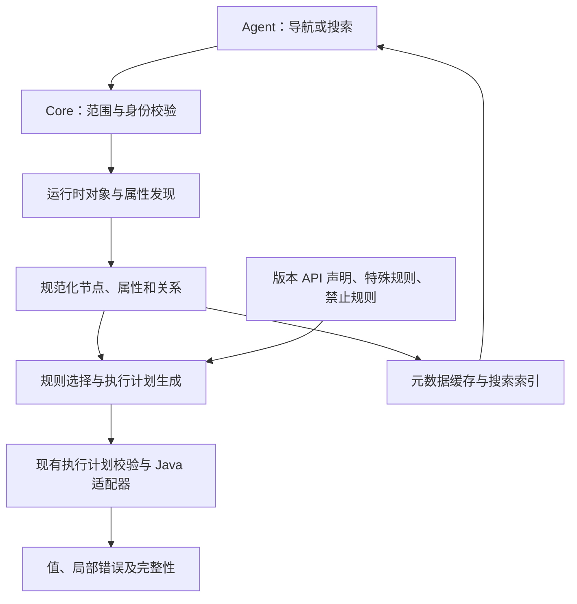

# 运行时对象树与属性发现规格

状态：只读发现和受控写入已实现并完成限定范围验收，包括正常赋值、写前拒绝、保存重载和写后不确定状态。实际支持范围及真实/模拟证据见[运行时发现说明](../runtime-discovery.md#验证范围)。

关联：[ADR 0001](../adr/0001-runtime-discovery.md) · [实施计划](plan-2026-10-30-12-24.md) · [现有 MCP 契约](../mcp.md)

## 目标与范围

StarBridge 应让 Agent 从实际算例的对象层级逐层发现设置，并按需取得属性说明、当前值、关联及能力状态。查询无需预先生成完整配置列表，也无需调用者知道 Java 类名、精确属性关键词或访问代码。

工作树在本文中指由运行时对象、分组和关系形成的导航结构。保留 STAR 的名称和上下文；不要求完全复刻 GUI 的排序、隐藏、折叠、图标或菜单。已确认的子对象和属性关联可以分别展开，复杂呈现差异不成为逐节点人工适配的要求。

首阶段仅新增导航、描述、读取和搜索能力。自动写入、创建删除、模型启停、方法切换、网格生成、求解、GUI 会话接管、常驻 Java 服务及工作记忆不属于首阶段交付。既有已适配写入仍按原契约使用，不因本规格扩大范围。

## 验证依据

2026-10-30，基于代码 `afebd8fe20a0804d51a4292f3db7d720f9e28363`，在 Linux、STAR 2602 Build `21.02.007` 上对真实 `Base.sim~` 的隔离副本进行了只读验证。输入 SHA256 为 `33d98c6cad076ae9959c2039b988c0aecb0154f7ac63d79a2a805a88ae5ce895`。下列事实作为方案依据，不是未来每个算例必须达到的固定数量。

| 观察项 | 结果与统计口径 |
|---|---|
| CSO 子对象遍历 | 6,224 个对象、462 种实际类型，无报错或预算截断；另有 38 条非 CSO 边未继续展开 |
| 范围过滤 | 原遍历包含 4,647 个材料数据库对象；选定算例配置分支后为 767 个对象、254 种类型 |
| 自动只读映射 | 按运行时类型与 getter 签名去重生成 449 项，来自 172 种实际类型，每项读取一个代表实例 |
| 类型适配 | 基础值 241 项、枚举 114 项、标量数量 82 项、向量 12 项；全部真实读取成功，重复读取一致 |
| 与旧目录比较 | 303 项既不匹配旧目录目标类型，其 getter 也未出现在旧读取成员中；这是候选子集，不是全配置语义覆盖率增量 |
| 数量关联 | 94 项数量 input 中，77 个底层数量对象不在子对象遍历结果里，需要通过 `getQuantity()` 访问 |
| 约束及例外 | 13 项取得运行时范围，45 项带范围注解，未命中 `dynamic=true`；212 项保留为元数据，原因包括未支持值类型、隐藏属性及缺少属性注解 |
| 执行复用 | 生成目录通过原 Core 校验，由原 `CatalogRuntime` 执行；原会话 CLI 另行读取时间步长成功 |
| 写入与状态 | 367 项具有 setter 元数据，全部生成属性仍为只读；没有调用 setter、保存、网格或求解；已有快照覆盖内容及原文件摘要不变，临时服务已关闭 |

449 项与原目录 142 个属性条目的统计口径不同，不计算简单覆盖率倍数。该实验未验证所有实例、模型状态、2510 新发现路径、非 CSO 提供器和动态范围方法，也未验证任何新增写入能力。算例加载后 `modified` 已为 `true`，不能用这一标志单独证明无变化。

详细结果保存在本机 `outputs/discovery-20261030/report.json`，另有 `mapping-candidates.json`、`generated-execution-readonly.json` 和读取结果。`outputs/` 与算例被 Git 忽略，其他检出不保证具有这些材料；本节保留必要结论。后续复现可使用授权的兼容真实算例，必须重新说明版本、对象范围和计数基准。

## 发现与执行原则

1. 先发现元数据，再按已接受规则读取值。不得遍历调用所有 getter，也不得从 Bean 注解或方法名称单独推断调用无副作用。
2. 支持的访问机制包括经核验的子对象／管理器枚举、Bean 描述符和类型专用 input 解包。新增节点优先复用机制规则；缺少规则时保留节点或属性及原因。
3. 只读执行计划来自实际描述符、精确版本 API 声明及规则，继续接受 Core 的成员签名、指纹、参数和调用效果校验。Agent 不提交 Java 代码、任意方法名或底层属性 key。
4. 人工规则维护类型语义、特殊操作、前置条件、需保持状态和例外。显式禁止优先于自动生成，特殊规则优先于通用规则；冲突或依据不足时不猜测执行。
5. 类及属性发现不证明当前实例可读写。未实例化类型可保留在版本材料中，但不能伪装成当前算例节点。
6. 不通过试写再恢复探测能力，不在读取时自动创建对象、切换方法、加载模型或执行求值任务。`Profile.getMethod(Class)` 等存在修改行为的访问路径不能进入只读规则。

## 逻辑架构

版本资料与类缓存可以提前准备，但首次查询不得要求用户导出全算例配置清单。系统可按需生成、缓存或导出计划；导出文件用于审阅和复现，不是查询的强制前置步骤。当前临时 Java 客户端模型继续使用，不依赖未实现的常驻对象句柄表或事件监听。

## 节点与关系契约

节点至少提供以下信息；字段名对应独立的发现 schema；公开参数和实际限制见运行时发现说明。

| 字段 | 约定 |
|---|---|
| `node_id` | 会话范围内的 opaque 引用，由 Bridge 解释，Agent 不拼接或推断其内部格式 |
| `kind` | `object`、`group` 或 `proxy`；虚拟分组不能冒充 STAR 服务对象 |
| `label` | STAR 名称或有明确来源的分组名称；不作为永久身份 |
| `java_class` | 实际类，未知或非 Java 服务节点可为 `null` |
| `breadcrumbs` | 结构化路径片段，名称中的 `/` 不作为解析分隔符 |
| `children_state` | `not_loaded`、`complete`、`partial`、`unsupported` 或 `error` |
| `property_state` | 独立于子节点的描述状态，使用同一组状态值 |
| `relations` | 已发现的拥有、引用和 input 背后对象关系，包含关系种类与目标引用 |
| `provenance` | 提供器、实际接口／描述符来源、版本和观察范围 |
| `relocation` | 是否具有跨加载可重新解析的路径；不能保证时明确标为仅当前会话可用 |

遍历按对象身份去重，但不同拥有／引用路径仍作为关系保留。循环通过引用表达，不无限展开。可枚举数量未知时返回未知，不填 `0`；只有成功枚举完成且没有元素时才表示空节点。

非 CSO 节点仅在已验证的通用接口可以枚举或描述时展开；其余返回代理类型及不支持原因。不能为了匹配 GUI 逐项建立特殊节点树。通过属性关联发现的数量、方法或选项可以保持独立关系，不强制伪装成 GUI 子节点。

同会话使用句柄时必须核对会话 token、服务身份、对象 key／类型和必要父关系；句柄可解析不代表对象仍有效。重命名、删除重建、方法切换和重新加载后，不能用同名对象静默替代旧对象。新会话应按可重建路径重新定位；同名歧义返回明确失败。

## 属性与能力契约

属性描述至少包含 `property_id`、程序名称、显示名称、说明、值类型、所属节点、来源和以下状态。`property_id` 由 Bridge 按版本及声明身份产生，不以翻译后的显示名称作为唯一 ID；签名或绑定变化必须使旧引用失效或要求重新描述。

| 状态 | 含义 |
|---|---|
| `discovered` | 已观察到属性描述，不暗示已执行 getter |
| `read_support` | `supported`、`unsupported` 或 `unknown`，附适配规则和原因 |
| `setter_present` | `true`、`false` 或 `null`；`null` 表示尚未确定 |
| `write_support` | 写入规则的支持状态，不能由 `setter_present` 自动推导 |
| `write_enabled` | 当前发布范围是否允许该路径；P1—P3 阶段一律为 `false`，P4 仅对完整编译的已接受规则开放，实例条件仍在写前检查 |
| `target_conditions` | `not_checked`、`satisfied`、`unsatisfied`、`unknown` 或 `error`，逐项给出依据与实际值 |
| `value_conditions` | 是否已针对具体新值检查；描述和读取不携带新值时保持未检查 |
| `evidence` | 对应版本、类型／实例和操作的观察证据；缺失不是成功，也不是当前实例失败 |

缺少条件声明不能自动返回 `satisfied`。明确规则认为某类操作无需额外条件时，应记录该规则依据，区别于尚未掌握条件。旧接口中的 `writable` 继续保持原“存在写入实现”的含义，不静默改成上述新状态。

数量值应保留原定义、单位、可取得的 SI 信息与真实分量；枚举保留当前值和当前允许选项。范围可来自注解或实际 input，但要保留来源、单位、端点和整数约束。仅描述符提供的范围不代替运行时值检查。`link` 是属性通知关联的依据，不能直接当作完整物理依赖关系。

按实际 getter 的声明类、签名及适用上下文去重，不能只按显示名合并。只有 input 的真实类型满足已支持规则时才解包；未知 input、自定义编辑器、对象选择器、查询及复杂引用先返回结构或元数据，不实例化编辑器来尝试写入。

`hidden`、`readOnly` 等标记保留原义及来源。GUI 隐藏不等于不存在，存在 setter 不等于当前可编辑。首阶段可以保守地让隐藏属性停留在描述状态，调用方应能看到这个限制。

## 交互接口

以下发现逻辑方法已由共享 Core 接入 JSON CLI 和 `starbridge.` 前缀的 MCP 工具；当前版本及限制见[使用说明](../runtime-discovery.md)。现有 `find_objects`、`describe_object`、`read_properties` 及 `modify` 不改变含义。任何名称调整需同步本规格和使用说明。

| 方法 | 主要输入 | 主要结果 |
|---|---|---|
| `browse_tree` | `session_dir`，可选 `node_id`、`scope`、分页和预算 | 省略节点时从算例根开始；返回一层子节点、完整性和下一页信息，不隐式递归扫描全树 |
| `describe_node` | `session_dir`，可选 `node_id`、`scope`、`property_ids`、`cursor`、`limit` | 返回属性元数据、支持状态及已知关系；必要的只读条件检查单独标明，不默认读取全部值 |
| `read_node_properties` | `session_dir`、`node_id`、明确的 `property_ids` | 返回选定属性的值、逐项错误、观察时刻和请求范围完整性 |
| `search_settings` | `session_dir`、`query`、范围与分页，可选发现扩展预算 | 返回候选节点／属性、树路径、匹配依据、引用及搜索覆盖状态；不修改算例 |
| `relocate_node` | `session_dir`、返回的结构化 `locator` | 在新会话重新解析唯一对象，不复用旧句柄 |
| `modify_node_property` | `session_dir`、`node_id`、`property_id`、`expected`、`value` | 按已接受规则执行一次赋值，返回回读、Diff 与快照验证范围；不自动保存 |

路径继续遵循现有绝对路径要求，会话调用继续持锁、核对版本并保留日志。新发现响应使用独立的 `schema_version`，外层复用 `ok`、`rejected`、`uncertain`、`error` 状态。单项不支持或读取失败可保留在成功响应中，但必须使对应范围为 `partial`／`error`，不能把空值冒充读取结果。

分页返回游标和排序依据；页间不承诺快照隔离，对象关系变化时重新校验或使游标失效。每个请求有深度、节点数、结果数量和耗时边界，并返回实际应用的预算及截断原因。默认不自动展开引用目标或整个材料数据库。默认值及上限已在[使用说明](../runtime-discovery.md#入口与参数)固化，不能依赖无限遍历实现正确性。

当前 `describe_node` 先刷新完整可观察描述并编译能力说明，再对响应应用属性选择与分页，内部读写保持范围不受分页裁剪。`limit` 默认 100、最大 500；显式 `property_ids` 接受 1–500 个唯一 ID，未知或过时 ID 明确拒绝。响应提供 `offset`、所选集合的 `total_count`、全部观察属性数量 `descriptor_total_count` 及 `next_cursor`。游标绑定节点、完整描述指纹和选择顺序；下一页可以省略选择以沿用游标内容，绑定变化必须重新描述。分页保留原观察范围的完整性状态，不能把局部观察变成完整观察。

典型流程为 `browse_tree` → 展开求解器 → `describe_node` → `read_node_properties`。用户只提供业务概念时，先 `search_settings`，再根据路径和说明确认候选并读取；搜索结果不能跳过对象身份检查。

## 搜索、文档、Skill 与缓存

搜索至少索引对象名称、结构化路径、属性显示名称、说明、程序标识及已知值类型。少量人工别名连接中文、英文和缩写，例如“松弛因子 / under-relaxation factor / URF”，不逐属性维护另一份配置清单。

搜索应区分当前已发现范围和经调用者明确预算扩展的范围，返回未展开节点、不支持节点、读取错误及截断信息。搜索只命中静态类型材料时，应标为类型知识而非当前实例。多个候选需要保留各自上下文，不根据模糊名称自动选取修改目标。

文档补充属性与操作的含义、版本限制和副作用；Skill 描述任务及检查顺序，通过 Bridge 查询实际节点。AI 训练知识可提出搜索方向，不能替代真实引用和当前值。首阶段不要求向量数据库或语义模型；缓存是信息的存储方式，不是独立事实来源。

缓存分层：

- 类元数据与编译计划按精确 release/Build、类／成员指纹、发现 schema 和规则版本隔离；规则或成员变化使相关条目失效。
- 对象索引、节点关系和引用绑定当前会话及其世代；服务重启、重新加载或对象身份变化后不得沿用旧引用。
- 当前值、允许选项、范围和可写条件带观察时刻及有效性说明；查询可明确返回缓存值，但不得标为刚从 server 读取。修改前的必要检查必须重新执行。

首阶段没有常驻事件监听时，使用请求时重查和必要的重新发现保证有效性；不能承诺能实时感知其他客户端的全部变化。缓存缺失应能在预算内重新建立所需信息，不要求提前完整扫描。

## 版本、迁移与后续写入

新能力先支持已核验的 2602 Build。既有 2510 目录和工具仍可用，但不继承本次实验的成功证据。元数据能发现新成员不代表自动支持新版本；当前精确版本绑定策略保持，类型规则按版本独立核验。

自动生成计划、缓存和人工规则分别存放。重新发现不能覆盖禁止规则、特殊条件或已维护的语义。现有属性 ID、schema 1 快照及既有文件／会话行为继续兼容；新对象发现不自动扩大旧快照的读取范围。

P4 受控写入须满足：

- **W1：支持依据明确。** 属性具有已接受的写入规则、完整参数绑定及适用条件；setter 元数据和只读成功均不足以开放写入。
- **W2：状态与新值检查。** 重新定位目标及关联，比较 `expected`，核对单位、范围、允许选项和模型／方法条件；实际调用前重新核对可能改变的必要状态。条件未知不按满足处理。
- **W3：结果可核验。** 单次执行后核对目标、需保持状态和声明的影响范围，保留 Diff、显式保存及文件重载；未建立足够影响范围前不取消现有快照检查。
- **W4：失败语义保留。** 写入前明确拒绝与写入可能发生后的不确定状态分开；不自动重试或假定通用回滚。读取范围、会话锁和回读都不构成跨客户端原子事务或 CFD 合理性保证。

当前写入规则及验收范围见[运行时发现说明](../runtime-discovery.md#受控写入)。其他写入范围继续按规则族逐批验收。创建删除、模型启停、方法切换及复杂查询继续使用具有明确语义的操作适配，不包装成任意属性赋值。

## 首阶段验收矩阵

| 编号 | 场景 | 通过标准 |
|---|---|---|
| R1 | 不知道精确 Java 标识符，沿树寻找时间步长或压力松弛因子 | 从根导航、描述并读取到目标；不需要预生成完整配置文件或新建逐属性映射 |
| R2 | 已支持类型的新属性 | 按规则自动生成并校验只读计划；记录签名、来源和实际值，不修改正式人工规则 |
| R3 | 数量只经 input 暴露，以及重复描述符 | 可读取底层数量；保留关联身份、单位和表达式；同一声明不因重复描述符被重复计数 |
| R4 | 非 CSO 代理、未知 input、隐藏属性及未确认只读的访问 | 使用已核验通用规则或返回明确不支持／未检查状态，不调用未知 getter 或编辑器 |
| R5 | 范围和枚举 | 保留运行时允许选项、范围及单位；分别验证静态注解、实际 input 范围和有真实实例的动态范围方法，缺失分支不报已通过 |
| R6 | 会话变化、对象消失／重建、歧义、缓存过期 | 拒绝失效引用或重新定位；不静默命中同名替代对象，未缓存的新查询可以按需执行 |
| R7 | 中文／英文概念搜索及部分索引 | 返回路径、匹配依据和真实引用；未展开或截断范围明确，空命中不解释为全算例不存在 |
| R8 | 循环、重复关系、分页、预算和单项错误 | 无无限遍历；返回范围及截断原因，保留成功项，未发现、空集合和失败能区分 |
| R9 | 只读与兼容边界 | 新生成属性均不开放写入；没有 setter、保存、模型加载或计算调用；原文件摘要及已有快照覆盖内容不变，旧入口代表性调用保持 |
| R10 | 精确版本及证据统计 | 错配版本拒绝；新版本不继承证据；发现数、类型属性数、实例读取数、写实现和实际验收分开统计 |

真实算例验收使用隔离工作副本，不改变用户原件。记录是否实际命中各分支、原文件摘要、已有快照及必要属性前后状态；不把 `modified` 标志或某个成功计数作为全部行为无副作用的证明。验证会话在结束后显式关闭。
