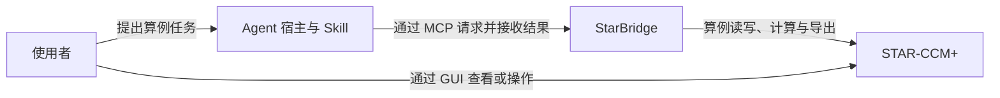
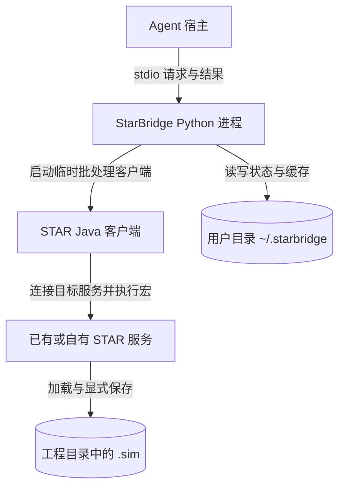
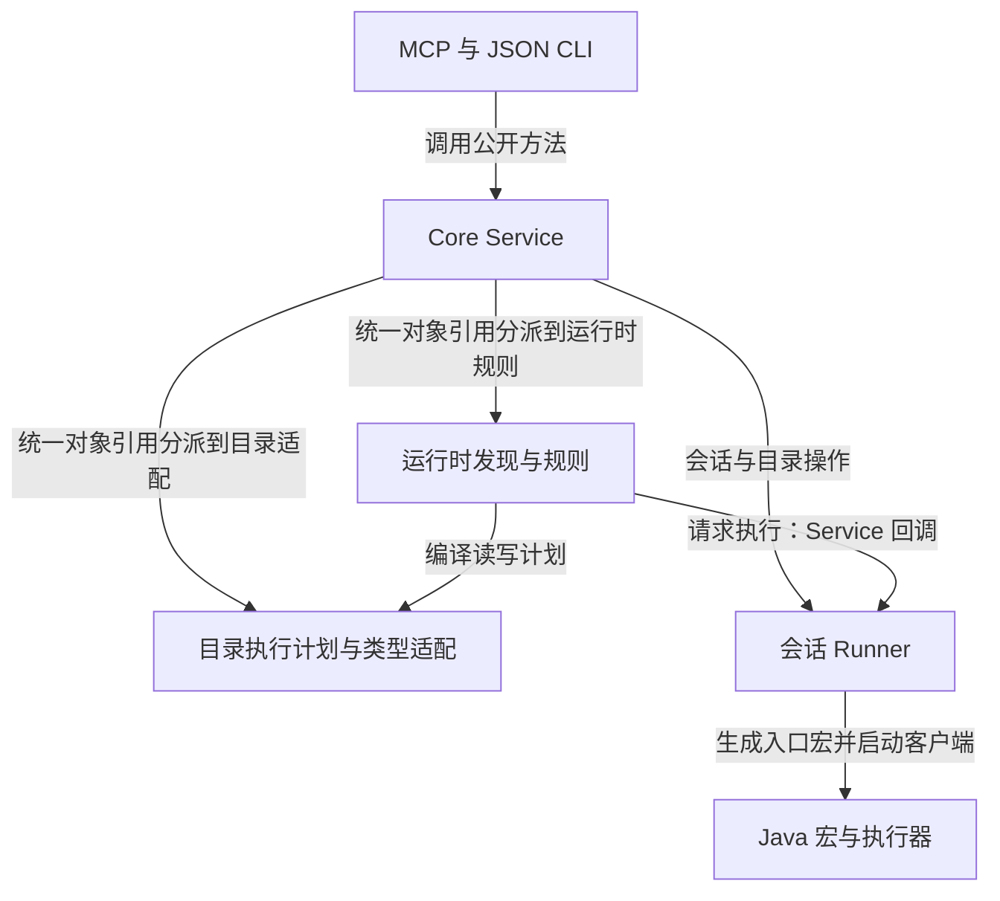

# 当前架构

[技术入口](index.md) · [需求文档](<../../StarBridge.md>) · [当前任务](../../TODO.md)

本文说明当前进程和组件如何协作。GUI 接入、保存和特定失败恢复已有真实运行依据，但不代表所有写入链路或异常均已覆盖；实际范围统一见[验证边界](<bridge-session.md#验证边界>)。

## 系统上下文（C4 L1）

StarBridge 向 Agent 提供结构化接口和通用 Java 步骤入口，STAR-CCM+ 持有实际算例状态并执行调用。Skill 组织领域检查顺序；当前设置来自实时读取。通用入口可调用当前版本的宏 API，不再以目录适配作为能力上限；工作记忆支持场景、方法和资料指引的检索与修订。小通道已走通网格、有限步计算、导出、关联导航及静态选择写入，对象参数也能用于通用宏和记忆方法。生命周期与目录版本支持分离；GUI 协同、请求恢复及标准节点模型的对应呈现已有实现与实际依据，具体范围及未验证部分见[通用执行与工作记忆](<generic-execution.md>)。

## 进程与存储（C4 L2）

以下展示共享会话入口。MCP 服务与 JSON CLI 使用同一套 Python 实现；JSON CLI 在调用它的进程中执行 Core，无需另外连接 MCP 服务。

Agent 宿主加载插件 Skill，并通过 stdio 启动 StarBridge MCP 进程。MCP 和共享 JSON CLI 把请求交给同一 Core Service；Core 解析统一对象引用并准备发现或目录计划，调用会话 Runner。Runner 连接已有 STAR 服务，或启动自有后台服务，再通过临时 Java 批处理客户端执行请求。客户端退出后 STAR 会话继续存在。

Java 代码在目标 STAR 会话中定位对象、检查必要条件、执行读取或修改并返回结构化结果。Python 侧负责会话身份、请求状态和结果整理。Linux 进程检查、会话文件锁和对象引用用于确定本次操作的对象；它们不阻止用户在 GUI 中同时修改算例，也不提供跨客户端事务。

插件环境、会话状态和缓存位于用户目录；`.sim` 保存到工程路径。参数化方法已提供网格／求解执行和图表／表／报告导出；通用宏仍负责方法库之外的操作。目录、生命周期和清理规则统一见[运行数据与项目产物](bridge-session.md#运行数据与项目产物)。

独立[文件 Runner](bridge-file.md)每次从文件加载，修改后另存并重载核对；它保留自己的调用与产物契约，不需要先建立共享会话。上图中的常驻 STAR 服务适用于[会话 Runner](bridge-session.md)。

插件启动和打包关系见[分发维护](distribution.md)，用户安装步骤见[分发说明](../distribution.md)；具体请求格式见 [MCP 契约](mcp.md)。

## Python 组件（C4 L3）

Service 校验公开方法和参数并形成状态封套；发现模块维护会话内引用、分页和索引，并按规则准备属性计划；目录模块复用已审阅的类型与操作适配。Runner 负责进程身份、互斥、客户端执行和请求状态，Java 执行器负责实际对象访问与回读。图只画请求依赖；目录模块将计划返回给调用者，再由 Service 组织执行，不反向调用 Service。

详细机制分别见[运行时发现](runtime-discovery.md)、[目录读取](catalog-runtime.md)、[目录修改](catalog-modifier.md)和[会话状态处理](bridge-session.md#身份和失败处理)。

## 接口与文档边界

| 入口 | 当前契约 | 阅读方式 |
|---|---|---|
| MCP／JSON CLI | `object_id`、`property_id` 和统一属性结果 | 查找与树导航共用描述、读取及修改入口，结构操作独立；见 MCP 契约。 |
| 底层目录 Runner | 类型、属性、操作标识及内部 `target` | 文件工作流与执行适配使用；不再发布另一套 MCP 读写方法。 |
| 按需审查 | Inspector schema 1 快照 | 保留快照与 Diff；旧 schema 1 修改、`set-scalar` 及结果投影已删除。 |
| 文件 Runner | 独立加载、另存和重载检查 | 文件流程的原文件摘要与重载检查不等于普通会话赋值的要求。 |

当前任务状态见 [TODO](../../TODO.md)。各专题中的历史实测记录保留原版本和场景，不代表最新会话、缓存或写入改造已经通过真实 STAR 验证。候选方案放在目标设计与路线图，接口说明只描述已有实现。

## 源码对应关系

| 文件或分组 | 职责 |
|---|---|
| [`cli.py`](../../src/starbridge/cli.py)、`__main__.py`、`mcp.py`、[`interfaces/mcp_server.py`](../../src/starbridge/interfaces/mcp_server.py) | 共享 JSON CLI、Python 模块和 MCP 入口；MCP 适配工具与资源。包内 `__init__.py` 组织命名空间及版本。 |
| [service.py](<../../src/starbridge/core/service.py>)、[objects.py](<../../src/starbridge/core/objects.py>)、[interface_contract.py](<../../src/starbridge/core/interface_contract.py>)、[interface_exposure.py](<../../src/starbridge/core/interface_exposure.py>) | 编排公开方法与状态封套；按任务展开相关契约，默认 MCP 只列稳定的展开／查询／执行入口，不读取业务资料。 |
| [macros.py](<../../src/starbridge/core/macros.py>)、[recipes.py](<../../src/starbridge/core/recipes.py>)、[memory.py](<../../src/starbridge/core/memory.py>) | 校验通用步骤和凭据；准备参数化方法；保存与检索带依据的项目／用户记忆，不自动执行记忆。 |
| [api_docs.py](<../../src/starbridge/core/api_docs.py>)、[execution_artifacts.py](<../../src/starbridge/core/execution_artifacts.py>) | 按需读取实际安装资料和固定请求材料，分别约束成功结果预算，保留来源、分页和读取限制；不把文本取得当成执行成功。 |
| [macro_execution.py](<../../src/starbridge/bridge/runner/macro_execution.py>)、[StarBridgeLaunch.java](<../../src/starbridge/bridge/java/StarBridgeLaunch.java>)、[StarBridgeProgram.java](<../../src/starbridge/bridge/java/StarBridgeProgram.java>) | 区分外部预编译、STAR入口编译与用户程序加载；同请求连续执行并记录逐步结果，恢复时读取旧凭据，不盲目重放。 |
| [GuiPresentation.java](<../../src/starbridge/bridge/java/GuiPresentation.java>) | 显式 GUI 位置方法使用的官方节点模型；读取根可达路径、属性栏及首层菜单元数据，不打开视图或执行动作。 |
| [`core/environment.py`](../../src/starbridge/core/environment.py)、`catalog_bundle.py`、`session_store.py` | 探测实际安装、选择已登记版本、解析会话与产物位置。 |
| [`core/discovery.py`](../../src/starbridge/core/discovery.py)、`discovery_rules.py`、`discovery_policy.py`、`discovery_write.py` | 运行时对象引用、分页与索引，版本规则、读计划和受控写计划。 |
| [`core/catalog.py`](../../src/starbridge/core/catalog.py)、`execution.py`、`snapshot.py`、`coverage.py` | 目录校验、执行计划、兼容快照布局和覆盖统计。 |
| [`bridge/runner/session_bridge.py`](../../src/starbridge/bridge/runner/session_bridge.py)、`file_bridge.py`、`modifier.py`、`java_runtime.py` | 会话与独立文件执行、通用结果比较，以及 Java 源码和编译缓存。 |
| [`bridge/java/BridgeFileMacro.java`](../../src/starbridge/bridge/java/BridgeFileMacro.java)、`CatalogRuntime.java`、`DiscoveryRuntime.java` | STAR 宏入口、目录执行器与对象树发现执行器。 |
| [`tools/catalog/catalog.py`](../../src/starbridge/tools/catalog/catalog.py)、`javadoc.py` | 离线目录命令及运行时共用的 Javadoc 解析。 |
| [`catalogs/`](../../src/starbridge/catalogs/) | 按 STAR 版本保存生成候选、人工执行映射、规则与快照布局；生成数据不是当前算例状态。 |
| [`integrations/plugin/launch.py`](../../integrations/plugin/launch.py)、相邻 MCP 配置 | 从插件源码启动服务，通过锁文件复用用户目录 Python 环境。 |
| [`.codex-plugin/`](../../.codex-plugin/)、[`.claude-plugin/`](../../.claude-plugin/)、[`integrations/deepseek-harness/`](../../integrations/deepseek-harness/)、[`package.json`](../../package.json) | 三端插件声明、DSH 适配器、bundle 与通用接入片段。 |
| [`skills/starbridge-case-audit/`](../../skills/starbridge-case-audit/) | 共用的只读算例审查工作流及宿主显示元数据，不维护 Java 绑定。 |
| 根 `starbridge.py`、`interfaces/mcp_server.py`、`bridge/runner/`、`tools/catalog/catalog.py` | 源码兼容转发脚本，实际实现位于 `src/starbridge/`。 |
| [`tools/validation/`](../../tools/validation/) | 已有发现、Java 和写入检查；具体真实运行证据与局限见对应专题。 |
| [`pyproject.toml`](../../pyproject.toml)、`uv.lock`、`MANIFEST.in`、`server.json` | Python 发行入口、锁定依赖、打包资源和待发布 Registry 元数据。 |

Python 要求和 MCP 依赖由 `pyproject.toml` 声明，插件按 `uv.lock` 准备环境。STAR 安装、许可证和本机 Javadoc 由运行环境提供，不随发行包交付；安装内 JDK 用于可复用 Java 辅助类编译。具体准备方式见分发说明，精确 Build 约束见版本说明。
