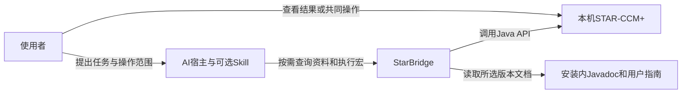
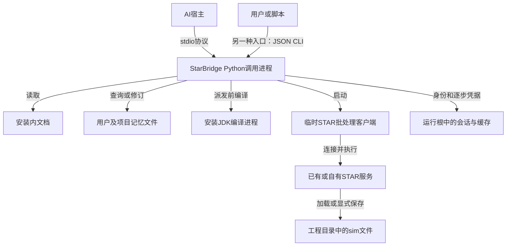
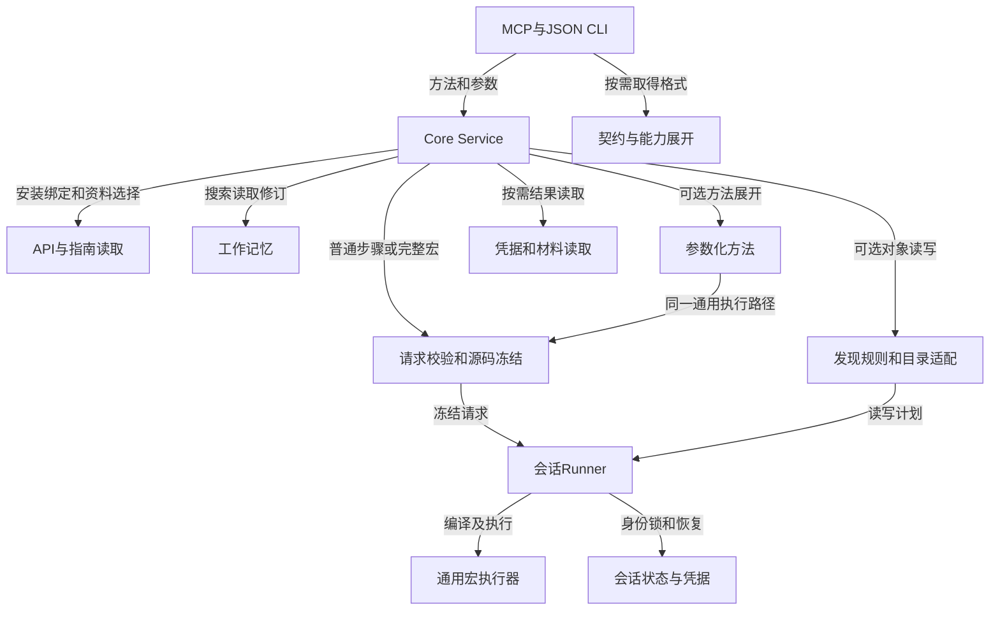

# 当前架构

[返回技术入口](<index.md>) · [日常使用](<../usage.md>) · [需求](<../../StarBridge.md>) · [当前任务](<../../TODO.md>)

当前源码在`f7eef68`架构基础上补充方法源码读取、结果视图和资源摘要；临时客户端与服务生命周期未改变。通用宏是正常操作路径，结构化对象接口是可选辅助。本文说明当前组件如何协作；实际运行范围见[历史任务依据](<../evidence/generic-execution.md>)，不能把源码核对当作新的STAR验证。

## 系统上下文（C4 L1）

AI负责理解问题、选择API、编写或复用代码并解释业务结果。StarBridge提供资料、记忆、会话和执行依据，不把功能限制为已适配的目录类型，也不自动认证物理正确性。Skill可以组织任务，但不是调用通用宏的前置条件。

生命周期与目录版本范围分离：通用路径以实际安装、编译和运行时身份为依据；结构化发现与目录写入仍要求各自的精确适配。查询不到资料、结构化接口不支持或宏返回，都不能分别等同于API不存在、操作不可做或任务全部完成。

## 进程与存储（C4 L2）

Core与Runner是调用进程中的Python代码，不是另一个常驻服务。MCP服务和JSON CLI使用同一Core；CLI无需连接MCP。资料查询、记忆查询及执行材料读取不启动STAR客户端。

算例操作复用已打开的STAR服务，但每次请求仍使用临时批处理客户端；客户端结束不自动关闭服务。连接优先复用匹配算例，必要时才启动自有服务并加载原文件，不默认创建保护副本。独立[文件Runner](<bridge-file.md>)保留自己的每次加载、另存和重载契约，不等同共享会话路径。

运行根默认是`~/.starbridge`，可用`STARBRIDGE_HOME`覆盖；项目记忆仍是显式项目目录中的`.starbridge/memory/`覆盖层，可沿用项目约定的共享位置。知识与精简案例证据分别保存，普通检索和读取只处理知识；结构及迁移见[工作记忆](<generic-execution.md#工作记忆的记录与使用>)。源码/JAR快照、凭据和缓存不是算例备份。存储与清理规则只在[会话说明](<bridge-session.md#运行数据与项目产物>)维护；插件依赖环境的独立位置见[分发维护](<distribution.md>)。

## Python组件（C4 L3）

### 一次通用请求如何完成

1. Service校验方法和参数。需要对象参数绑定时，先准备当前引用；完整宏的显式源码/JAR由准备模块读取、摘要并冻结，不递归复制工程。
2. 会话Runner管理互斥、进程与加载对象身份。执行器在派发前用所选安装JDK编译，成功后让STAR只编译薄启动器，再加载本请求的用户程序与冻结依赖。
3. Java包装器在身份与对象绑定通过后开始用户初始化，按步骤记录结果。完整来源宏保持自身构造、路径和`execute()`语义，不自动获得包装器的参数或业务结果容器。
4. Python整理持久凭据，并独立生成compact/full传输视图与登记进程资源摘要，不改原凭据、不额外启动客户端。相同请求不重新执行；失败、部分完成或未知结果保留原状态，由调用者核查后决定下一步。详细契约见[通用执行](<generic-execution.md>)。

当前纯代码没有顶层`sources/classpath`参数；显式辅助源码/JAR属于完整宏步骤。预编译成功的包装器类族使用本次类目录，其他类型与资源保留父优先；未完成的helper加载扩展不是当前实现。

### 并发与失败边界

Linux进程身份、会话锁和对象引用帮助确定当前目标，但不阻止GUI或另一运行根并发修改算例，不提供跨客户端事务。`effect`和`scope`是调用者声明，不是Java沙箱。编译、初始化、步骤、客户端进程及整个业务任务的完成必须分别判断。

未知写入不会因一次读取成功自动解除，也不自动回滚。通用宏可按已有依据显式接受当前状态；旧结构化修改与保存仍有恢复范围缺口。算法和字段约定见[状态与恢复](<generic-execution.md#完成与恢复>)及[会话身份](<bridge-session.md#身份和失败处理>)。

## 源码对应关系

| 文件或分组 | 职责与关系 |
| --- | --- |
| [cli.py](<../../src/starbridge/cli.py>)、[mcp.py](<../../src/starbridge/mcp.py>)、[MCP适配器](<../../src/starbridge/interfaces/mcp_server.py>)；包内`__main__.py`、`__init__.py` | 模块、命令与协议入口；包初始化组织命名空间和版本。 |
| [service.py](<../../src/starbridge/core/service.py>)、[objects.py](<../../src/starbridge/core/objects.py>) | 公开方法编排、结果封套及统一对象引用绑定。 |
| [interface_contract.py](<../../src/starbridge/core/interface_contract.py>)、[interface_exposure.py](<../../src/starbridge/core/interface_exposure.py>) | 当前调用契约、默认三个入口、按任务展开方法格式；不读取业务资料。 |
| [api_docs.py](<../../src/starbridge/core/api_docs.py>)、[guide_docs.py](<../../src/starbridge/core/guide_docs.py>)、[javadoc.py](<../../src/starbridge/tools/catalog/javadoc.py>) | 安装绑定、官方索引和正文解析；保留版本、继承、预算和缺失范围。 |
| [macros.py](<../../src/starbridge/core/macros.py>)、[macro_sources.py](<../../src/starbridge/core/macro_sources.py>) | 通用请求校验、指纹、完整宏及依赖冻结与物化。 |
| [recipes.py](<../../src/starbridge/core/recipes.py>)、[memory.py](<../../src/starbridge/core/memory.py>)、[memory_safety.py](<../../src/starbridge/core/memory_safety.py>) | 展开方法、记录及检索知识；写前检查常见认证值并生成无原文诊断，不扫描引用或自动执行。 |
| [execution_receipt.py](<../../src/starbridge/core/execution_receipt.py>)、[execution_review.py](<../../src/starbridge/core/execution_review.py>)、[execution_artifacts.py](<../../src/starbridge/core/execution_artifacts.py>) | 凭据读取、已有依据审阅及日志/请求材料的有界窗口读取。 |
| [result_view.py](<../../src/starbridge/core/result_view.py>)、[session_resources.py](<../../src/starbridge/core/session_resources.py>) | 独立于执行的结果传输视图、登记进程RSS与保留原因；不改凭据、不自动保存或关闭。 |
| [session_bridge.py](<../../src/starbridge/bridge/runner/session_bridge.py>)、[server_discovery.py](<../../src/starbridge/bridge/runner/server_discovery.py>)、[lifecycle_execution.py](<../../src/starbridge/bridge/runner/lifecycle_execution.py>) | 服务发现、会话请求与生命周期派发。 |
| [macro_execution.py](<../../src/starbridge/bridge/runner/macro_execution.py>)、[java_runtime.py](<../../src/starbridge/bridge/runner/java_runtime.py>) | 安装库编译、类冲突检查、启动器生成与客户端执行。 |
| [StarBridgeLaunch.java](<../../src/starbridge/bridge/java/StarBridgeLaunch.java>)、[StarBridgeProgram.java](<../../src/starbridge/bridge/java/StarBridgeProgram.java>) | 薄启动和任务包装器，分别处理运行加载与逐步初始化/执行凭据。 |
| [GuiPresentation.java](<../../src/starbridge/bridge/java/GuiPresentation.java>) | 官方标准节点模型的路径、属性栏与首层菜单标签；不打开视图或执行动作。 |
| [environment.py](<../../src/starbridge/core/environment.py>)、[session_store.py](<../../src/starbridge/core/session_store.py>)、[catalog_bundle.py](<../../src/starbridge/core/catalog_bundle.py>) | 安装探测、会话存储与目录资源选择。 |
| [discovery.py](<../../src/starbridge/core/discovery.py>)、[discovery_rules.py](<../../src/starbridge/core/discovery_rules.py>)、[discovery_policy.py](<../../src/starbridge/core/discovery_policy.py>)、[discovery_write.py](<../../src/starbridge/core/discovery_write.py>) | 可选结构化发现：对象引用、索引、读计划和受控写计划。 |
| [catalog.py](<../../src/starbridge/core/catalog.py>)、[execution.py](<../../src/starbridge/core/execution.py>)、[snapshot.py](<../../src/starbridge/core/snapshot.py>)、[coverage.py](<../../src/starbridge/core/coverage.py>) | 目录校验、执行适配、快照兼容与覆盖统计。 |
| [file_bridge.py](<../../src/starbridge/bridge/runner/file_bridge.py>)、[modifier.py](<../../src/starbridge/bridge/runner/modifier.py>) | 独立文件流程与结构化结果比较。 |
| [BridgeFileMacro.java](<../../src/starbridge/bridge/java/BridgeFileMacro.java>)、[CatalogRuntime.java](<../../src/starbridge/bridge/java/CatalogRuntime.java>)、[DiscoveryRuntime.java](<../../src/starbridge/bridge/java/DiscoveryRuntime.java>) | 文件宏、目录计划和运行时对象访问。其他生命周期Java模板归会话Runner使用。 |
| [目录工具](<../../src/starbridge/tools/catalog/catalog.py>)、[版本资源](<../../src/starbridge/catalogs/>) | 离线目录生成与人工映射；生成资料不是当前算例状态。 |
| [插件启动器](<../../integrations/plugin/launch.py>)、[DSH适配器](<../../integrations/deepseek-harness/>)、[Codex声明](<../../.codex-plugin/>)、[Claude声明](<../../.claude-plugin/>) | 三端分发、共享Python环境和宿主配置；[安装测试Skill](<../../skills/starbridge-install-test/>)仅返回固定标记，不承担算例任务指导。 |
| [Python发行配置](<../../pyproject.toml>)、[依赖锁](<../../uv.lock>)、[资源清单](<../../MANIFEST.in>)、[Registry元数据](<../../server.json>)、[DSH包配置](<../../package.json>) | 发行入口、依赖和打包资源，见[分发维护](<distribution.md>)。 |
| 根兼容入口：[starbridge.py](<../../starbridge.py>)、[MCP转发](<../../interfaces/mcp_server.py>)、[Runner转发](<../../bridge/runner/>)、[目录转发](<../../tools/catalog/catalog.py>) | 保留旧命令路径，实际实现位于Python包内。 |
| [既有检查脚本](<../../tools/validation/>) | 按被检查模块组织；历史通过或失败不能代替当前实现的运行依据。 |

## 接口与文档边界

- [MCP与JSON CLI](<mcp.md>)维护业务方法、参数、结果与按需入口；结构化接口使用schema 2的`object_id/property_id`，通用宏不以这些属性目录为能力上限。
- [运行时发现](<runtime-discovery.md>)、[目录读取](<catalog-runtime.md>)和[目录修改](<catalog-modifier.md>)维护可选结构化路径；底层类型/操作标识与内部`target`不另发布一套MCP接口。
- [Inspector](<inspector.md>)保留schema 1快照与Diff；旧schema 1修改、`set-scalar`及结果投影已删除。文件流程的摘要和重载要求不自动成为普通会话赋值要求。
- [历史任务依据](<../evidence/generic-execution.md>)只记录已做的范围，不随文档同步改写成新验证；当前未完成工作只在[TODO](<../../TODO.md>)维护，目标与方案不冒充当前架构。

## 开发依赖与限制

Python要求和MCP依赖由[发行配置](<../../pyproject.toml>)声明，插件依赖由[锁文件](<../../uv.lock>)固定。STAR安装、许可证、安装内JDK及文档由执行环境提供，不随发行包交付。MCP进程不会热重载源码；升级后需重启MCP连接，但无需因此重新加载已有算例。安装与客户端接入见[分发说明](<../distribution.md>)。
